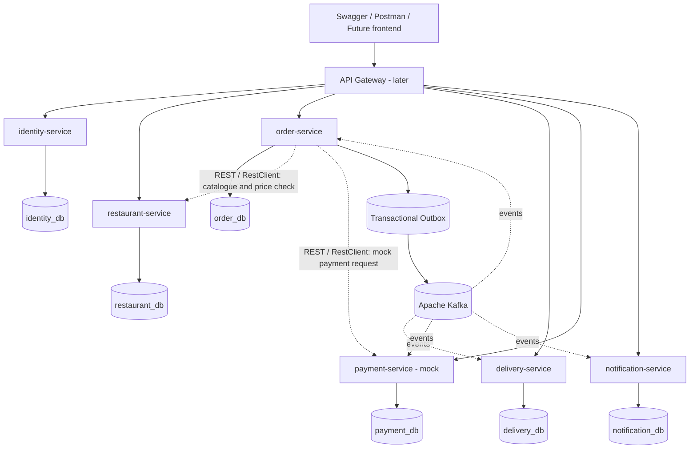
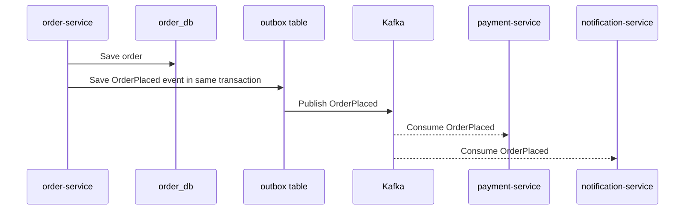
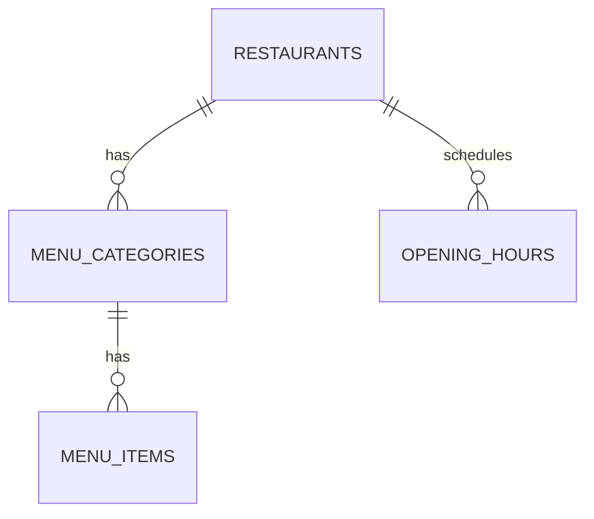

# FastBite — Software Architecture Plan

## 1. Purpose and scope

FastBite is a portfolio-ready backend project for a simplified food ordering and delivery platform. It is intentionally developed in small phases so that each architectural decision can be understood, tested and explained.

The initial scope is backend only. REST APIs and Swagger will be added during the restaurant-service phase; a frontend comes after the backend services are established.

Out of scope for the MVP:

- Real card processing or storage of card details.
- Live GPS tracking, maps or route optimisation.
- Promotions, ratings and complex dispatch algorithms.
- Kubernetes or production cloud deployment.

## 2. Design principles

- A service owns a business capability and its data.
- Every service has its own PostgreSQL database. A local machine may run them in one PostgreSQL instance, but services never perform cross-service SQL joins or foreign keys.
- Use REST for synchronous questions that need an immediate answer.
- Use Kafka for asynchronous facts that happened in the business domain.
- Do not introduce Kafka, a gateway or extra services before there is a concrete use case.
- Keep inputs validated, errors explicit and secrets outside Git.
- Authorization requires both a role and, where needed, ownership of the resource.
- Prefer small vertical slices over implementing all infrastructure on day one.

## 3. Target system architecture

The API gateway is part of the target architecture, not the first milestone. During Phase 1, `restaurant-service` is exposed directly and explored through Swagger.

## 4. Services and responsibilities

| Service | Owns | Responsibilities | Planned phase |
| --- | --- | --- | --- |
| `restaurant-service` | Restaurants, menu categories, menu items | Public catalogue, owner-managed restaurants and item availability | 1 |
| `identity-service` | Users, roles, password hashes, refresh tokens | Register, login, refresh/logout and JWT issuance | 2 |
| `order-service` | Orders, order items, status history | Checkout, price snapshots, totals and valid order transitions | 3 |
| `delivery-service` | Drivers, deliveries, assignments | Driver availability, assignment and delivery status | 4 |
| `payment-service` | Mock payment records and refunds | Simulated payment outcomes only | 5 |
| `notification-service` | Notification records when persistence is needed | Consume events and create/log notifications | 6 |

### Identity and authorization

The identity service owns users and security data. The initial roles are:

- `CUSTOMER`
- `RESTAURANT_OWNER`
- `DELIVERY_DRIVER`
- `ADMIN`

`ADMIN` has full administrative privileges. Other roles require both a role check and an ownership check. For example, a restaurant owner may edit only restaurants they own, and a delivery driver may update only their own delivery assignment.

Passwords are stored only as strong hashes. Tokens are short-lived JWT access tokens, with refresh-token handling planned in the identity service. No user table belongs in `restaurant-service`.

## 5. Communication model: REST and Kafka

FastBite uses a hybrid architecture. Kafka does not replace REST.

### REST: synchronous communication

Services use Spring `RestClient` when a response is needed immediately.

Example: during checkout, `order-service` asks `restaurant-service` whether menu items are available and retrieves their current prices before creating the order snapshot.

REST calls need timeouts, controlled retries and clear error handling. Services must not trust a user identifier received from another service without authentication and authorization rules.

### Kafka: asynchronous communication

Kafka is introduced in **Phase 3** with `order-service`. A producer publishes a business event after an important state change; consumers process that event independently.

Spring Kafka components:

- `KafkaTemplate` produces events to a topic.
- `@KafkaListener` consumes events from a topic.
- A **topic** is a named stream of events.
- An **event** is an immutable message describing something that already happened.

Kafka is configured locally through Docker Compose when Phase 3 begins. Until then, it is not part of the local stack.

## 6. Kafka event flow and reliability

Initial event contracts are versioned and documented before implementation. Planned examples:

| Event | Producer | Expected consumers | When introduced |
| --- | --- | --- | --- |
| `OrderPlaced` | `order-service` | `payment-service`, `notification-service`, later `delivery-service` | Phase 3 |
| `PaymentCompleted` | `payment-service` | `order-service`, `notification-service` | Phase 5 |
| `OrderDelivered` | `delivery-service` | `order-service`, `notification-service` | Phase 4 |

Suggested topic names use an explicit version, for example `orders.placed.v1`, `payments.completed.v1` and `orders.delivered.v1`.

When a database change and an event must remain consistent, use the **Transactional Outbox Pattern**: store the business change and outgoing event in one database transaction, then publish the saved event separately. This avoids losing an event after a successful database commit.

Consumers must be idempotent: receiving the same event twice must not create duplicate work. Error handling is added as services begin consuming events:

- controlled retries for temporary failures;
- dead-letter topics for messages that repeatedly fail;
- logging and observability around failed processing.

This reliability work is introduced where it has value, not as unused infrastructure in Phase 1.

## 7. Restaurant-service data model

The first service owns restaurant catalogue data.

Planned tables:

| Table | Purpose |
| --- | --- |
| `restaurants` | Restaurant details, owner reference, address and active state |
| `menu_categories` | Categories belonging to one restaurant |
| `menu_items` | Available menu items, price and currency |
| `opening_hours` | Opening schedule; implemented later in the restaurant phase |

The current first migration creates the initial `restaurants` table. Later changes are introduced through new Flyway migrations rather than editing an already-applied migration.

## 8. REST API plan

All APIs will be versioned under `/api/v1`. Public responses use DTOs; JPA entities are never exposed directly.

Planned restaurant endpoints:

| Method | Endpoint | Access | Description |
| --- | --- | --- |
| `GET` | `/api/v1/restaurants` | Public | Paged and filtered restaurant search |
| `GET` | `/api/v1/restaurants/{restaurantId}` | Public | Restaurant details |
| `GET` | `/api/v1/restaurants/{restaurantId}/menu` | Public | Categories and available menu items |
| `POST` | `/api/v1/restaurants` | Owner/Admin | Create restaurant |
| `PATCH` | `/api/v1/restaurants/{restaurantId}` | Owner/Admin + ownership | Update restaurant |
| `POST` | `/api/v1/restaurants/{restaurantId}/categories` | Owner/Admin + ownership | Create a menu category |
| `POST` | `/api/v1/restaurants/{restaurantId}/items` | Owner/Admin + ownership | Create a menu item |
| `PATCH` | `/api/v1/restaurants/{restaurantId}/items/{itemId}/availability` | Owner/Admin + ownership | Enable or disable an item |

Swagger/OpenAPI documents these endpoints once the REST layer is added. Until JWT authentication exists, owner-only endpoints are either postponed or protected by a clearly documented local-only development setup; unsecured owner endpoints are not treated as production-ready.

HTTP behaviour will use meaningful status codes and `ProblemDetail` error responses:

- `400` for invalid input;
- `401` for missing or invalid authentication;
- `403` for insufficient permissions or ownership;
- `404` for missing resources;
- `409` for conflicts or invalid state transitions.

## 9. Development roadmap

| Phase | Scope | Main outcomes |
| --- | --- | --- |
| 1 | Restaurant Service | REST API, PostgreSQL, Flyway, Swagger and tests |
| 2 | Identity Service | Spring Security, JWT, authentication and authorization |
| 3 | Order Service + Kafka | Orders, order items, Kafka producer/consumer and event publishing |
| 4 | Delivery Service | Delivery management and Kafka events |
| 5 | Payment Service | Mock payments and Kafka events |
| 6 | Notification Service | Kafka consumers and notifications |
| 7 | Quality and delivery | CI/CD, monitoring, integration tests and improvements |

## 10. Technology stack

- Java 21
- Spring Boot and Gradle
- PostgreSQL
- Spring Data JPA / Hibernate
- Flyway
- Docker and Docker Compose
- Spring Web, REST/JSON and Spring `RestClient`
- Apache Kafka and Spring Kafka
- Spring Security and JWT
- Bean Validation
- Springdoc OpenAPI / Swagger
- JUnit 5, Mockito and Testcontainers
- GitHub Actions, monitoring and structured logging in later phases

## 11. Testing and quality plan

| Test type | Purpose |
| --- | --- |
| Unit tests | Business rules, validation and state transitions; Mockito when isolation is useful |
| Repository integration tests | JPA mapping and Flyway migrations against PostgreSQL |
| Web/API tests | Request validation, status codes, DTO responses and security rules |
| Event tests | Event contracts, idempotency and consumer error handling |
| End-to-end tests | Happy path from catalogue to order, payment and delivery after the relevant services exist |

Testcontainers is planned for realistic PostgreSQL and Kafka integration tests when it provides value. GitHub Actions will run automated quality checks on Pull Requests in Phase 7.

## 12. Current status

The current focus is Phase 1 and `restaurant-service`.

Implemented foundation:

- Spring Boot / Gradle project setup;
- PostgreSQL Docker Compose configuration;
- environment-variable based local configuration with an ignored `.env` file;
- Flyway migration for the initial restaurant table;
- JPA entity, repository and repository-test foundation.

Next steps:

1. Complete the restaurant and menu data model through new Flyway migrations.
2. Add DTOs, services, validation and error handling.
3. Implement restaurant REST endpoints.
4. Add Swagger/OpenAPI and API tests.

No Kafka, JWT, frontend or additional service is implemented yet. These remain intentional future phases.
