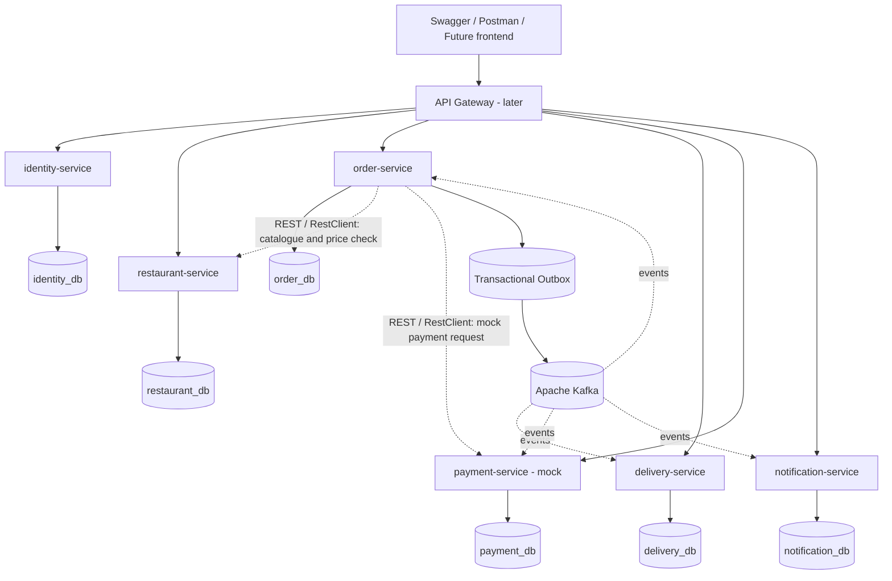
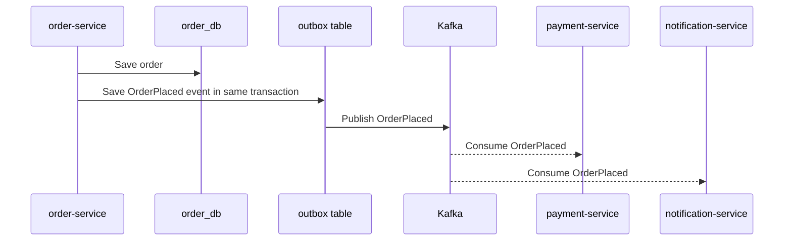
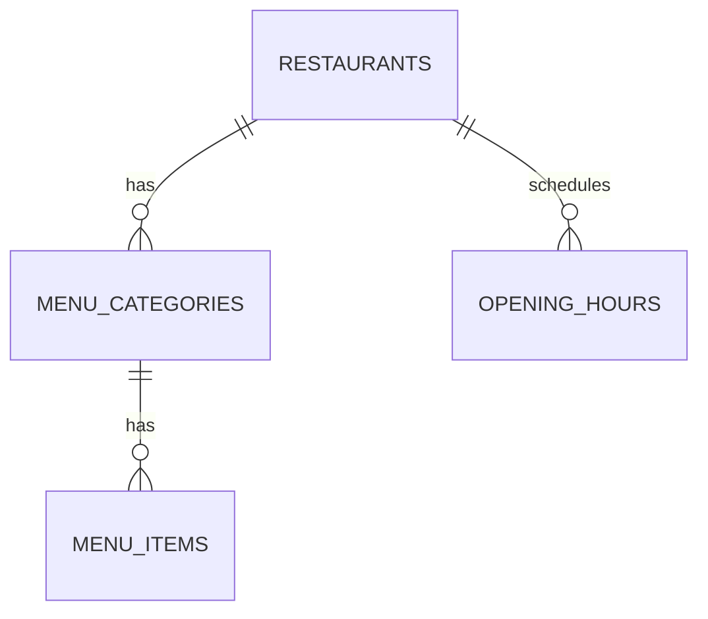

# FastBite — Software Architecture Plan

## 1. Purpose and scope

FastBite is a portfolio-ready backend project for a simplified food ordering and delivery platform. It is intentionally developed in small phases so that each architectural decision can be understood, tested and explained.

The initial scope is backend only. Restaurant/menu and guest-order REST APIs with Swagger are implemented in two independent services, and a third service, identity-service, has its user and role foundation in place. A frontend comes after the backend services are established.

Out of scope for the MVP:

- Real card processing or storage of card details.
- Live GPS tracking, maps or route optimisation.
- Promotions, ratings and complex dispatch algorithms.
- Kubernetes or production cloud deployment.

## 2. Design principles

- A service owns a business capability and its data.
- Every service has its own PostgreSQL database. A local machine may run them in one PostgreSQL instance, but services never perform cross-service SQL joins or foreign keys.
- Use REST for synchronous questions that need an immediate answer.
- Use Kafka for asynchronous facts that happened in the business domain.
- Do not introduce Kafka, a gateway or extra services before there is a concrete use case.
- Keep inputs validated, errors explicit and secrets outside Git.
- Authorization requires both a role and, where needed, ownership of the resource.
- Prefer small vertical slices over implementing all infrastructure on day one.

## 3. Target system architecture

The diagram shows the target architecture. Currently, restaurant-service and order-service are exposed directly and have their own Swagger documentation. The API gateway and the remaining services are planned.

## 4. Services and responsibilities

| Service | Owns | Responsibilities | Phase | Status |
| --- | --- | --- | --- | --- |
| `restaurant-service` | Restaurants, menu categories, menu items | Public catalogue, owner-managed restaurants and item availability | 1 | Implemented; owner authorization planned |
| `identity-service` | Users, roles, password hashes, refresh tokens | Register, login, refresh/logout and JWT issuance | 2 | Registration and JWT login implemented; refresh tokens planned |
| `order-service` | Orders, order items, status history | Checkout, price snapshots, totals and valid order transitions | 3 | Guest checkout implemented; status transitions and events planned |
| `delivery-service` | Drivers, deliveries, assignments | Driver availability, assignment and delivery status | 4 | Planned |
| `payment-service` | Mock payment records and refunds | Simulated payment outcomes only | 5 | Planned |
| `notification-service` | Notification records when persistence is needed | Consume events and create/log notifications | 6 | Planned |

### Identity and authorization

The identity service owns users and security data. The initial roles are:

- `CUSTOMER`
- `RESTAURANT_OWNER`
- `DELIVERY_DRIVER`
- `ADMIN`

`ADMIN` has full administrative privileges. Other roles require both a role check and an ownership check. For example, a restaurant owner may edit only restaurants they own, and a delivery driver may update only their own delivery assignment.

Passwords are stored only as strong hashes. Tokens are short-lived JWT access tokens, with refresh-token handling planned in the identity service. No user table belongs in `restaurant-service`.

## 5. Communication model: REST and Kafka

FastBite uses a hybrid architecture. Kafka does not replace REST.

### REST: synchronous communication

Services use Spring `RestClient` when a response is needed immediately.

Example: during checkout, `order-service` asks `restaurant-service` whether menu items are available and retrieves their current prices before creating the order snapshot.

The current checkout client has connection/read timeouts and explicit error handling. It reuses GET /restaurants/{restaurantId}/menu to retrieve available products from active categories of an active restaurant. It does not retry automatically; controlled retries can be added when needed. Future authenticated service calls must validate identity and authorization.

### Kafka: asynchronous communication

Kafka remains planned for Phase 3. Guest checkout has been implemented first, without event publishing. In the planned event flow, a producer publishes a business event after an important state change and consumers process it independently.

Spring Kafka components:

- `KafkaTemplate` produces events to a topic.
- `@KafkaListener` consumes events from a topic.
- A **topic** is a named stream of events.
- An **event** is an immutable message describing something that already happened.

Kafka is configured locally through Docker Compose when Phase 3 begins. Until then, it is not part of the local stack.

## 6. Kafka event flow and reliability

Initial event contracts are versioned and documented before implementation. Planned examples:

| Event | Producer | Expected consumers | When introduced |
| --- | --- | --- | --- |
| `OrderPlaced` | `order-service` | `payment-service`, `notification-service`, later `delivery-service` | Phase 3 |
| `PaymentCompleted` | `payment-service` | `order-service`, `notification-service` | Phase 5 |
| `OrderDelivered` | `delivery-service` | `order-service`, `notification-service` | Phase 4 |

Suggested topic names use an explicit version, for example `orders.placed.v1`, `payments.completed.v1` and `orders.delivered.v1`.

When a database change and an event must remain consistent, use the **Transactional Outbox Pattern**: store the business change and outgoing event in one database transaction, then publish the saved event separately. This avoids losing an event after a successful database commit.

Consumers must be idempotent: receiving the same event twice must not create duplicate work. Error handling is added as services begin consuming events:

- controlled retries for temporary failures;
- dead-letter topics for messages that repeatedly fail;
- logging and observability around failed processing.

This reliability work is introduced where it has value, not as unused infrastructure in Phase 1.

## 7. Restaurant-service data model

The first service owns restaurant catalogue data.

| Table | Purpose | Status |
| --- | --- | --- |
| `restaurants` | Restaurant details, address, location (city, municipality, region) and active state | Implemented; owner reference planned with authorization |
| `menu_categories` | Categories belonging to one restaurant, with display order and active state | Implemented |
| `menu_items` | Menu items with price, currency and availability | Implemented |
| `opening_hours` | Opening schedule | Planned |

The schema is created and evolved by Flyway migrations V1–V5. Changes are always introduced through new migrations rather than by editing an already-applied migration.

## 8. REST API plan

The target API plan uses /api/v1. Current controllers use unversioned paths, including GET /restaurants/{restaurantId}/menu and POST /restaurants/{restaurantId}/orders. The table below remains the target API plan. Public responses use DTOs; JPA entities are never exposed directly.

Planned restaurant endpoints:

| Method | Endpoint | Access | Description |
| --- | --- | --- | --- |
| `GET` | `/api/v1/restaurants` | Public | Paged and filtered restaurant search |
| `GET` | `/api/v1/restaurants/{restaurantId}` | Public | Restaurant details |
| `GET` | `/api/v1/restaurants/{restaurantId}/menu` | Public | Categories and available menu items |
| `POST` | `/api/v1/restaurants` | Owner/Admin | Create restaurant |
| `PATCH` | `/api/v1/restaurants/{restaurantId}` | Owner/Admin + ownership | Update restaurant |
| `POST` | `/api/v1/restaurants/{restaurantId}/categories` | Owner/Admin + ownership | Create a menu category |
| `POST` | `/api/v1/restaurants/{restaurantId}/items` | Owner/Admin + ownership | Create a menu item |
| `PATCH` | `/api/v1/restaurants/{restaurantId}/items/{itemId}/availability` | Owner/Admin + ownership | Enable or disable an item |

Swagger/OpenAPI documents the implemented restaurant/menu and order endpoints. The access roles in the target table are planned: authentication and authorization are not implemented yet. Current management endpoints are for local development and are not ready for public deployment.

Current errors use ApiError with timestamp, status, code, message, path and fieldErrors. Each service has its own ApplicationException base, concrete exceptions with an ErrorCode and message, and GlobalExceptionHandler. Relevant HTTP statuses, including planned authentication/status-transition behaviour, are:

- `400` for invalid input;
- `401` for missing or invalid authentication;
- `403` for insufficient permissions or ownership;
- `404` for missing resources;
- `409` for conflicts or invalid state transitions (planned).
- `503` when checkout cannot obtain a valid response from restaurant-service.

## 9. Development roadmap

| Phase | Scope | Main outcomes | Status |
| --- | --- | --- | --- |
| 1 | Restaurant Service | REST API, PostgreSQL, Flyway, Swagger and tests | Done |
| 2 | Identity Service | Spring Security, JWT, authentication and authorization | In progress |
| 3 | Order Service + Kafka | Orders, order items, Kafka producer/consumer and event publishing | Guest checkout done; Kafka planned |
| 4 | Delivery Service | Delivery management and Kafka events | Planned |
| 5 | Payment Service | Mock payments and Kafka events | Planned |
| 6 | Notification Service | Kafka consumers and notifications | Planned |
| 7 | Quality and delivery | CI/CD, monitoring, integration tests and improvements | Planned |

Guest checkout was built before authentication so that the REST communication between order-service and restaurant-service could be designed early. Orders will be linked to authenticated customers once identity-service issues JWTs.

## 10. Technology stack

- Java 21
- Spring Boot and Gradle
- PostgreSQL
- Spring Data JPA / Hibernate
- Flyway
- Docker and Docker Compose
- Spring Web, REST/JSON and Spring `RestClient`
- Apache Kafka and Spring Kafka
- Spring Security and JWT
- Bean Validation
- Springdoc OpenAPI / Swagger
- JUnit 5, Mockito and Testcontainers
- GitHub Actions, monitoring and structured logging in later phases

## 11. Testing and quality plan

| Test type | Purpose |
| --- | --- |
| Unit tests | Business rules, validation and state transitions; Mockito when isolation is useful |
| Repository integration tests | JPA mapping and Flyway migrations against PostgreSQL |
| Web/API tests | Request validation, status codes, DTO responses and security rules |
| Event tests | Event contracts, idempotency and consumer error handling |
| End-to-end tests | Happy path from catalogue to order, payment and delivery after the relevant services exist |

Testcontainers is planned for realistic PostgreSQL and Kafka integration tests when it provides value. GitHub Actions will run automated quality checks on Pull Requests in Phase 7.

## 12. Current status

Three independently buildable Spring Boot applications exist:

| Service | Implemented responsibility | Owned database |
| --- | --- | --- |
| restaurant-service | Restaurants, menu categories, menu items and the public catalogue | restaurant_db |
| order-service | Guest order creation, item snapshots and total calculation | order_db |
| identity-service | User and role model, PBKDF2 password encoder, registration validation and error handling | identity_db |

Each service has its own Gradle build/wrapper, application class, database configuration and Flyway migrations. Restaurant-service owns its V1–V5 catalogue migrations, order-service owns `V1__create_orders.sql` for orders and order_items, and identity-service owns `V1__create_users_and_roles.sql`, which also inserts the four roles.

### Implemented checkout flow

1. The client sends customer name, phone, delivery address and product IDs/quantities to POST /restaurants/{restaurantId}/orders on order-service. Prices are read from the catalogue, not accepted from the customer.
2. RestaurantClient uses Spring RestClient to call GET /restaurants/{restaurantId}/menu on restaurant-service. That API exposes only available products in active categories of an active restaurant.
3. Order-service rejects missing requested products and mixed currencies, snapshots product names/prices and calculates line totals and the order total.
4. It persists Order and OrderItem in order_db and returns OrderResponse, excluding customer phone and delivery address.

Order.restaurantId and OrderItem.menuItemId are external UUID references. Order-service does not import restaurant-service entities or repositories, query restaurant_db, or define foreign keys to catalogue tables. The OrderItem-to-Order relationship and foreign key are local to order_db.

### Build and tests

Build and test commands are documented in the [root README](README.md) and in each service README. Identity/JWT, Kafka, delivery, mock payment, notifications and the frontend follow the roadmap in section 9.

## 13. Common package structure

All services follow the same convention under their application package:

| Folder | Responsibility |
| --- | --- |
| config | Spring configuration, including OpenAPI, HTTP-client and password-encoder configuration where needed |
| restaurant, order or identity | The service's business feature |
| feature/controller | HTTP endpoints |
| feature/dto | Request/response data, including contracts consumed from another API |
| feature/exception | ApplicationException, ErrorCode, ApiError, GlobalExceptionHandler and concrete exceptions |
| feature/mapper | Conversion between DTOs and entities |
| feature/model | Entities and their local business rules |
| feature/repository | Access to the service's own database |
| feature/service | Use-case coordination and business checks |
| feature/client | Calls to another service, when required; currently order/client |

Each application class sits at the root of its application package. Tests mirror production packages. Every service keeps application.properties and db/migration under src/main/resources.

Keep this convention for new work. Add a folder only when the service has a responsibility that needs it; restaurant-service does not need an empty client folder.
