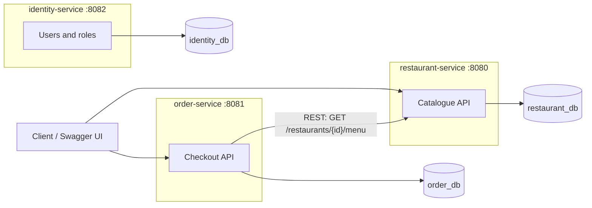

# FastBite

FastBite is a backend for a simplified food ordering platform, built as independent Spring Boot microservices. Customers browse restaurants and menus, and place orders whose prices are validated against the restaurant catalogue.

The project focuses on clear service boundaries: each service owns its business capability and its own PostgreSQL database, and services communicate only through their APIs.

## Features

- **Restaurant catalogue:** create and update restaurants, menu categories and menu items.
- **Public browsing:** search active restaurants by city, municipality or region with pagination, view restaurant details and view a restaurant's menu of available items.
- **Guest checkout:** place an order without an account. Prices are read from the restaurant service, never from the client, and stored as snapshots on the order.
- **Identity foundation:** users with multiple roles, PBKDF2 password hashing and registration validation.
- **Consistent API errors:** every service returns the same error format with an error code, message, path and field errors.
- **OpenAPI documentation:** Swagger UI for every service.

## Architecture



During checkout, order-service calls the restaurant-service public menu API to check which items are available and what they cost. It then stores the order with a snapshot of each item's name and price, so later menu changes never alter past orders.

The target architecture, including Kafka events, the transactional outbox and the remaining services, is described in [ARCHITECTURE.md](ARCHITECTURE.md).

## Services

| Service | Responsibility | Port | Database | Docs |
| --- | --- | --- | --- | --- |
| [restaurant-service](restaurant-service/README.md) | Restaurants, menu categories, menu items, public catalogue | 8080 | restaurant_db | `/swagger-ui/index.html` |
| [order-service](order-service/README.md) | Guest checkout, order items, price snapshots, totals | 8081 | order_db | `/swagger-ui/index.html` |
| [identity-service](identity-service/README.md) | Users, roles, password hashing | 8082 | identity_db | Register and login endpoints in progress |

## Design decisions

- **Database per service.** Services never share JPA entities, repositories, tables or foreign keys. Order-service stores `restaurantId` and `menuItemId` as plain UUID references.
- **Server-side pricing.** The client sends only item IDs and quantities. Order-service fetches current prices and availability from restaurant-service, so a client cannot set its own price.
- **Price snapshots.** Each order item keeps the name and unit price at the time of the order.
- **Fault handling for remote calls.** The REST client uses connection and read timeouts, validates the response and returns `503 Service Unavailable` when restaurant-service cannot be reached or returns invalid data.
- **Schema owned by Flyway.** Hibernate runs with `ddl-auto=validate`; every schema change is a versioned migration.
- **DTOs at the API boundary.** Entities are never exposed. Sensitive fields, such as customer phone numbers and password hashes, are excluded from responses.

## Tech stack

Java 21 · Spring Boot · Spring Web (RestClient) · Spring Data JPA / Hibernate · PostgreSQL · Flyway · Bean Validation · Spring Security Crypto · springdoc OpenAPI · JUnit 5 · Mockito · MockMvc · Docker Compose · Gradle

## Getting started

### Prerequisites

- Java 21
- Docker Desktop
- Each service has its own Gradle Wrapper, so Gradle does not need to be installed.

### 1. Start the restaurant database

Create a local environment file from the example and set a password:

```bash
cp .env.example .env            # Windows PowerShell: Copy-Item .env.example .env
docker compose up -d restaurant-db
```

`.env` is ignored by Git. Spring Boot does not read it automatically, so pass the same values to the application as environment variables (for example in the IDE run configuration).

### 2. Provide databases for the other services

order-service and identity-service each expect their own database (`order_db` and `identity_db`). They can run on the same local PostgreSQL server as separate databases. The required variables are listed in each service README.

### 3. Run the services

From each service folder:

```bash
./gradlew bootRun               # Windows: .\gradlew.bat bootRun
```

Start restaurant-service before placing orders, because order-service calls it during checkout.

### 4. Try it

Open Swagger UI:

- Restaurant service: http://localhost:8080/swagger-ui/index.html
- Order service: http://localhost:8081/swagger-ui/index.html

A typical flow is: create a restaurant, create a menu category, add menu items, then place an order:

```http
POST http://localhost:8081/restaurants/{restaurantId}/orders
Content-Type: application/json

{
  "customerName": "Maria Papadopoulou",
  "customerPhone": "6900000000",
  "deliveryAddress": "Ermou 10, Athens",
  "items": [
    { "menuItemId": "<menu item UUID>", "quantity": 2 }
  ]
}
```

The response contains the order ID, status, item snapshots, total amount and currency.

## Running tests

From a service folder:

```bash
./gradlew test                  # Windows: .\gradlew.bat test
```

Tests cover domain rules, services (Mockito), controllers and error responses (MockMvc), and the REST client. restaurant-service also has repository tests that run against PostgreSQL, so its database must be running for the full suite. See each service README for details.

## Repository layout

```
fastbite/
├── ARCHITECTURE.md        # Target architecture, roadmap, conventions
├── docker-compose.yml     # Local PostgreSQL for restaurant-service
├── .env.example           # Example local database settings
├── restaurant-service/
├── order-service/
└── identity-service/
```

Every service follows the same package convention: `config`, then a feature package with `controller`, `dto`, `exception`, `mapper`, `model`, `repository`, `service` and, where needed, `client`.

## Roadmap

- Registration, login and JWT authentication in identity-service
- Role- and ownership-based authorization for restaurant management
- Order lookup and order status transitions
- Docker Compose setup for all services and databases
- Integration tests with Testcontainers and CI with GitHub Actions
- Kafka events with a transactional outbox (`OrderPlaced`) and a notification-service consumer
- API gateway, delivery and mock payment services

Payments will always be simulated. This is a learning and portfolio project.
